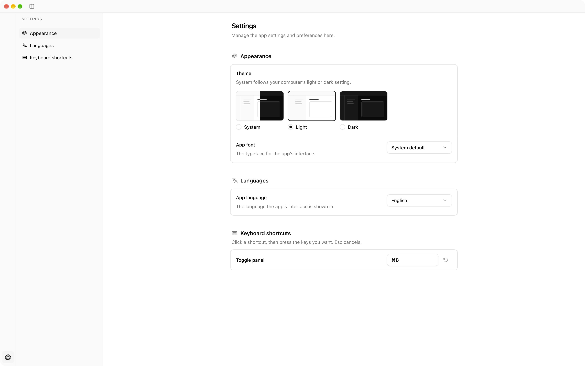
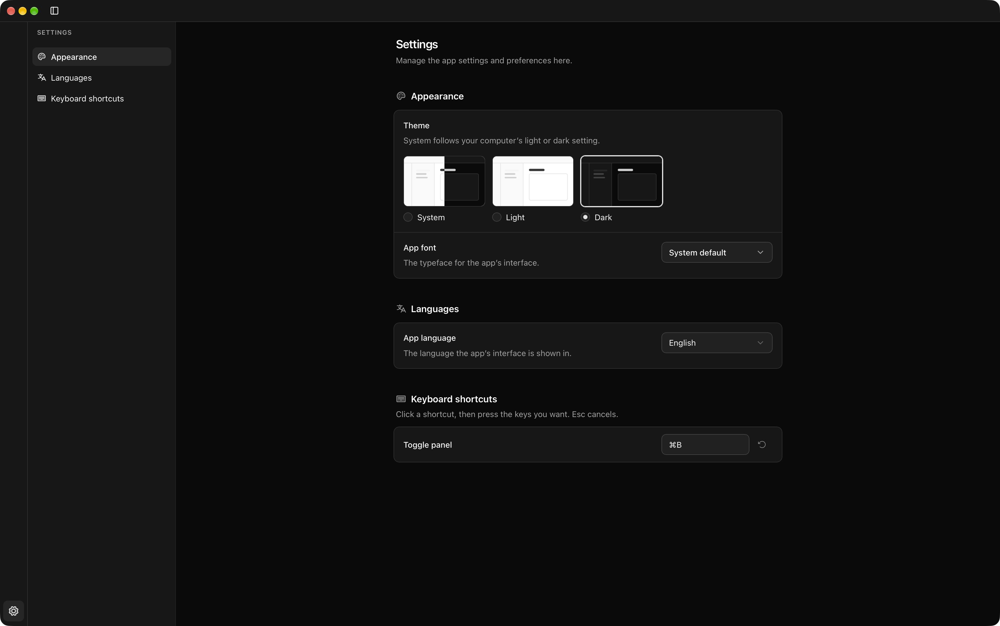
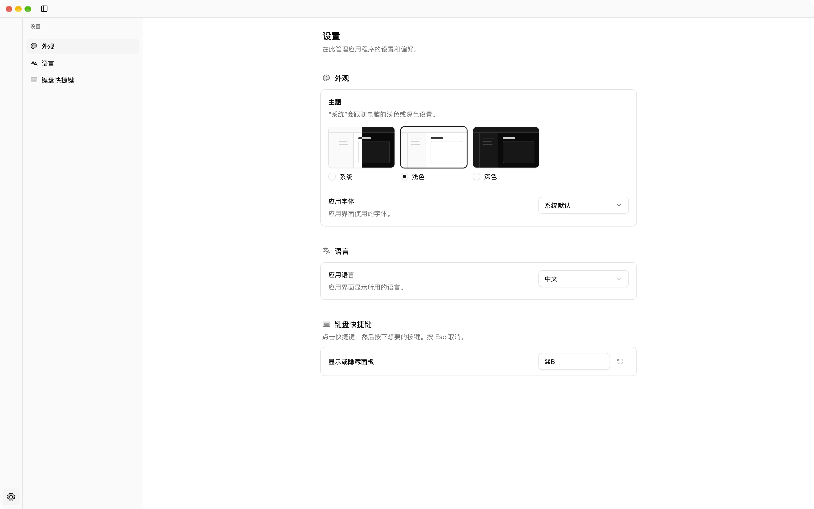

# tauriv2-vue-desktop-starter

A desktop application starter using the libraries and technologies:

- Rust
  - [Tauri v2](https://v2.tauri.app/start/) as the desktop application framework.
  - [SQLx](https://github.com/launchbadge/sqlx) with SQLite for persistence, with queries checked at compile time.
  - [Tauri Log Plugin](https://v2.tauri.app/plugin/logging/) for logging.
  - [Tauri OS Plugin](https://v2.tauri.app/plugin/os-info/) for platform detection.
  - [Tauri Fontgres Plugin](https://github.com/seferino-fernandez/tauri-plugin-fontgres) lists the installed fonts, so the app font can be changed in Settings.
  - [CrabNebula DevTools](https://v2.tauri.app/develop/debug/crabnebula-devtools/) for development.

- Vue.js 3
  - [Shadcn Vue + Tailwind CSS v4](https://www.shadcn-vue.com/) for components.
  - [Vue Router](https://router.vuejs.org/) for application routing.
  - [Vue I18n](https://vue-i18n.intlify.dev/) for internationalization.
  - [Pinia](https://pinia.vuejs.org/introduction.html) for state management.

- AI Support
  - [Tauri Pilot](https://github.com/mpiton/tauri-pilot) lets AI agents inspect, interact with, and debug Tauri applications in real-time. `tauri-pilot mcp` serves the same tools over MCP: add `{"command": "tauri-pilot", "args": ["mcp"]}` to your agent's MCP config

## Preview

### _Settings, light theme_



### _Settings, dark theme_



### _Settings, in Chinese_



## Recommended IDE Setup

- [VS Code](https://code.visualstudio.com/) + [Volar](https://marketplace.visualstudio.com/items?itemName=Vue.volar) + [Tauri](https://marketplace.visualstudio.com/items?itemName=tauri-apps.tauri-vscode) + [rust-analyzer](https://marketplace.visualstudio.com/items?itemName=rust-lang.rust-analyzer)

## Prerequisites

Follow [Tauri's prerequisites guide](https://v2.tauri.app/start/prerequisites/) to setup your development environment.

Then give the app your own name and [bundle identifier](https://v2.tauri.app/reference/config/#identifier):

```sh
just rename "My App" com.example.myapp
```

If you want to replace the package manager update:

- The build configuration in [tauri.conf.json](./src-tauri/tauri.conf.json)
- The `Install pnpm, Node.js and Frontend Dependencies` step in [.github/workflows/release.yml](.github/workflows/release.yml) and [.github/workflows/pull-request-validation.yml](.github/workflows/pull-request-validation.yml)

## Installation

Install dependencies with `pnpm install`

## Development

For **Desktop** development, run: `pnpm tauri dev`

### Internationalization (i18n)

[Vue I18n](https://vue-i18n.intlify.dev/)

#### Adding a new language

Create a new JSON file in the [locales](./src/i18n/locales/) directory with the appropriate translations and the locale as the filename.

Then update the `supportedLanguages` function in [lib/config.ts](./src/lib/config.ts) to include the new language.

### Helpful Tips

Settings are saved in a SQLite database, `app.db` (`app-dev.db` in debug builds), at:

**macOS**: `~/Library/Application Support/com.github.tauriv2-vue-desktop-starter`

**Linux**: `~/.local/share/com.github.tauriv2-vue-desktop-starter`

#### Guides

- [Layout](./docs/layout.md): the titlebar, activity bar and nested panel, and how to add a page with or without a panel
- [Native-feel CSS](./docs/native-feel-css.md): the global CSS that makes the WebView feel native, plus cross-webview gotchas
- [Linux](./docs/linux.md): native decorations, `.deb`/`.rpm` vs AppImage, and fixes for blank windows on some GPUs
- [Offline by default](./docs/offline.md): bundled icons, the system font, and the Content Security Policy
- [App font](./docs/fonts.md): choosing an installed font, how it is applied, and the fontgres plugin
- [Database](./docs/database.md): where the SQLite file lives, migrations, the query cache, and how to add a setting
- [Rust commands](./docs/rust-commands.md): where commands run and how to avoid freezing or crashing the app
- [Updater](./docs/updater.md): opt-in in-app updates that only check when the user asks, and how to sign and publish them

#### App Icon

Tauri CLI provides an [icon command](https://v2.tauri.app/reference/cli/#icon) `pnpm tauri icon` which takes an image path and generates icon files for your application.

## Contributing

Contributions are welcome! Feel free to:

- Open issues for bugs or feature requests
- Submit pull requests for improvements
- Provide feedback on existing features
- Suggest documentation improvements
- Help with translations

## Deployment & Release

[Tauri v2 Deployment Guide](https://v2.tauri.app/distribute/)

To build a binary, run:

```bash
pnpm tauri build
```

This repo is currently setup to create a release on Github when you merge to the `release` branch. See [https://github.com/tauri-apps/tauri-action/tree/dev](https://github.com/tauri-apps/tauri-action/tree/dev).

### Caveats

If you are using the [signing identity](./src-tauri/tauri.macos.conf.json) `-` for **macOS**, when you first download and run the application, you will have to go to `System Settings` > `Privacy & Security` and allow your app to run.
See [tauri-apps/tauri-action/issues/824](https://github.com/tauri-apps/tauri-action/issues/824) & [support.apple.com/open-a-mac-app-from-an-unidentified-developer](https://support.apple.com/guide/mac-help/open-a-mac-app-from-an-unidentified-developer-mh40616/mac).

On **Linux**, recommend the `.deb` or `.rpm` to users and offer the AppImage as a portable fallback. See [docs/linux.md](./docs/linux.md#packages-prefer-deb--rpm).
